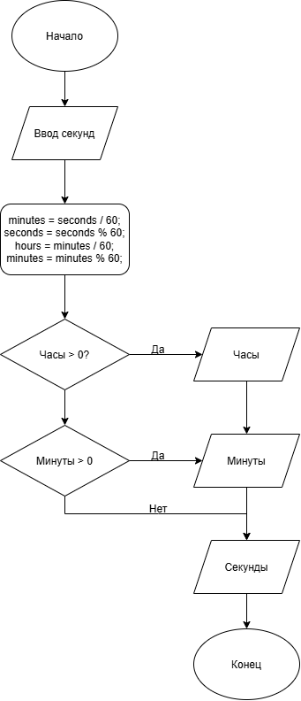

# Домашнее задание к работе 6

## Условие задачи
 Написать программу, которая переводит время из секунд в целое
значение часов, минут, секунд (если значение часов равно 0, то слово час не
выводится.
---
## 1. Алгоритм и блок схема

### Алгоритм
1. **Начало**
2. Объявить переменные:
   - `seconds` - кол-во секунд
   - `minutes` - кол-во минут
   - `hours` - кол-во часов
   - `oldSeconds` - входное кол-во секунд
3. Вычислим кол-во минут, как частное от целочисленного деления `oldSeconds` на `60`. Запишем остаток от деления в `seconds`
4. Вычислим кол-во часов, как частное от целочисленного деления `minutes` на `60`. Запишем остаток от деления в `minutes`
5. Выведем результат в формате `... часов ... минут ... секунд`. Если hours = 0 `... минут ... секунд`, если hours = 0 и minutes = 0 `... секунд`.
6. **Конец**

### Блок-схема


 
 ## 2. Реализация программы

```c
#include <stdio.h>
#include <locale.h>
int main(){
	setlocale(LC_ALL, ".UTF8");
	int hours, minutes ,seconds;

	scanf_s("%d", &seconds);

	long oldSeconds = seconds;

	minutes = seconds / 60;
	seconds = seconds % 60;
	hours = minutes / 60;
	minutes = minutes % 60;

	if (hours)
		printf("%d секунд = %d часов %d минут %d секунд", oldSeconds, hours, minutes, seconds);
	else if (minutes)
		printf("%d секунд = %d минут %d секунд", oldSeconds, minutes, seconds);
	else printf("%d секунд = %d секунд", oldSeconds, seconds);
	return 0;
	system("pause");
}
```
# 3. Результаты работы программы
50000 секунд = 13 часов 53 минут 20 секунд
# 4. Информация о разработчике
Балнов Артём бОТИ-262
